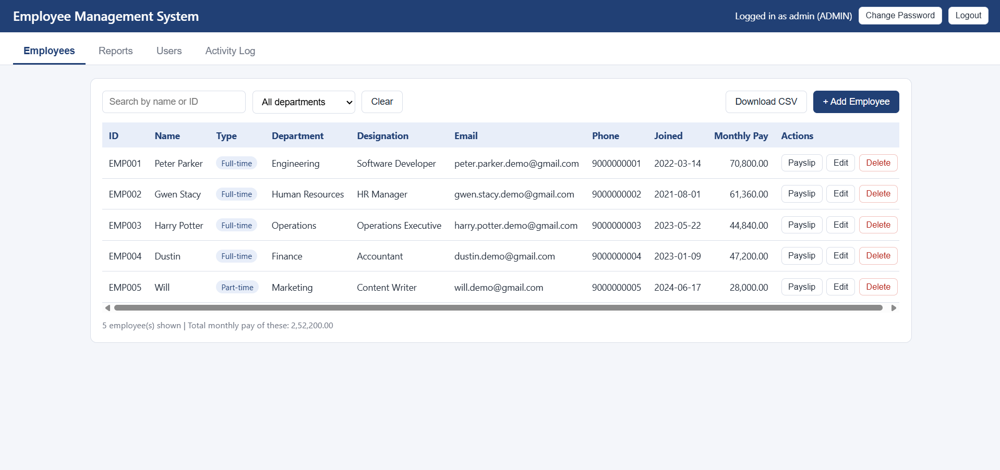
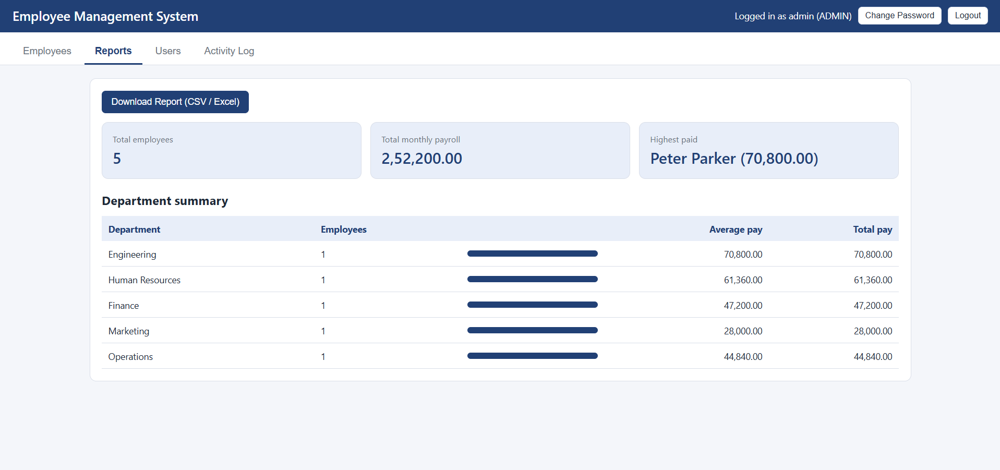
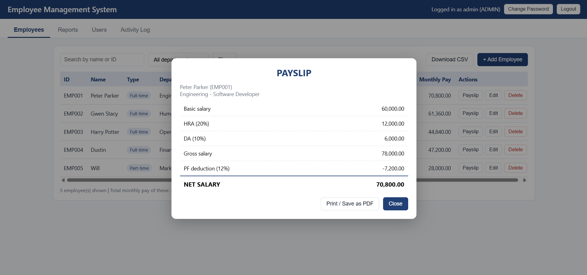

# Employee Management System (Web)

A full-stack web application: **Spring Boot REST API + JWT login + role-based access + MySQL + browser front end**,
with automated tests and a CI pipeline.

## Features
- **Secure login** with JWT tokens and BCrypt-hashed passwords
- **3 roles:** ADMIN (everything), HR (manage employees), VIEWER (read-only)
- **Employees:** add, edit, delete, search, filter by department
- **Pay:** full-time (Basic + HRA + DA - PF) and part-time (hourly), with a payslip view
- **Reports:** total payroll, highest paid, department-wise count and average pay
- **Downloads:** report as a CSV file (opens in Excel), and a printable payslip (Print > Save as PDF)
- **Activity log** (admin): who logged in, added, edited or deleted what
- **Validation** on every request and clean JSON error messages
- **Tests:** unit tests plus end-to-end API tests (MockMvc + H2), run automatically by GitHub Actions

| Role   | View / search / reports | Add / edit / delete employees | Users + activity log |
|--------|:---:|:---:|:---:|
| ADMIN  | yes | yes | yes |
| HR     | yes | yes | no  |
| VIEWER | yes | no  | no  |

## Tech stack
Java 17, Spring Boot 3.5 (Web, Data JPA, Security, Validation), Hibernate, MySQL, JWT (jjwt), JUnit 5, Mockito/MockMvc, H2 (tests), Maven, plain HTML/CSS/JavaScript, GitHub Actions.

## Run it locally
1. Install JDK 17+, MySQL Server, and the VS Code **Extension Pack for Java**.
2. Open `src/main/resources/application-local.properties` and put your MySQL password after `spring.datasource.password=`.
3. Open this folder in VS Code and wait for the Maven import to finish.
4. Open `src/main/java/com/vei/ems/EmsApplication.java` and click **Run** above `main`.
5. Open <http://localhost:8080> in your browser.
6. Log in with `admin` / `Admin@123`, then change the password.

The database `ems_web` and all tables are created automatically. Five sample employees are added on the first run
(turn this off with `app.seed-sample-data=false`).

## Run the tests
VS Code: Testing panel > play button. Or in a terminal: `mvn test`

## Architecture
```
Browser (HTML/JS) --JSON + JWT--> Controller --> Service --> Repository --> MySQL
                                     |              |
                                  DTOs +        business rules
                                  validation    (pay, duplicates)
```
- `web/` REST controllers and `GlobalExceptionHandler`
- `service/` business rules (`EmployeeService`, `AuthService`, `ReportService`, `PayCalculator`)
- `repository/` Spring Data JPA interfaces
- `domain/` JPA entities and enums
- `dto/` request and response objects (the API never exposes raw entities)
- `security/` `JwtService`, `JwtAuthFilter`; `config/` `SecurityConfig`, `DataSeeder`

## REST API
| Method | URL | Who | Purpose |
|---|---|---|---|
| POST | /api/auth/login | anyone | get a JWT token |
| POST | /api/auth/change-password | logged in | change own password |
| GET | /api/employees?search=&department= | logged in | list, search, filter |
| GET | /api/employees/{id} | logged in | one employee |
| GET | /api/employees/{id}/payslip | logged in | payslip |
| POST | /api/employees | ADMIN, HR | add |
| PUT | /api/employees/{id} | ADMIN, HR | update |
| DELETE | /api/employees/{id} | ADMIN, HR | delete |
| GET | /api/reports/summary | logged in | report numbers |
| GET | /api/reports/export | logged in | download the report as CSV |
| GET, POST | /api/users | ADMIN | list / create users |
| GET | /api/audit | ADMIN | latest 100 actions |

Send the token as the header `Authorization: Bearer <token>`.

## Security notes
- Passwords are stored as BCrypt hashes, never as plain text.
- All SQL goes through JPA (parameterised), which prevents SQL injection.
- The front end escapes all text it displays, which prevents script injection (XSS).
- Before putting the app online: set `JWT_SECRET` and `ADMIN_PASSWORD` as environment variables.
- `src/main/resources/application-local.properties` is in `.gitignore`, so your MySQL password is never uploaded.

## Roadmap
Attendance and leave management, Docker, deployment, pagination.

## Screenshots



